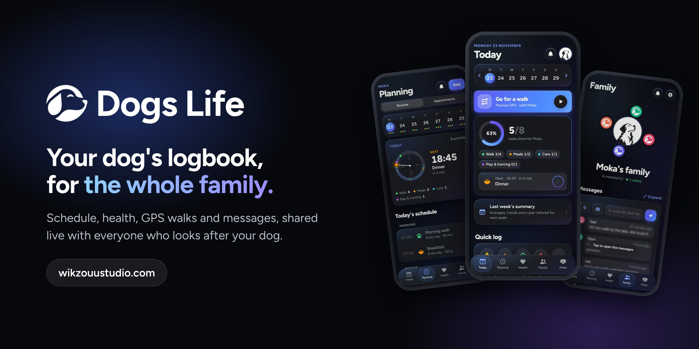
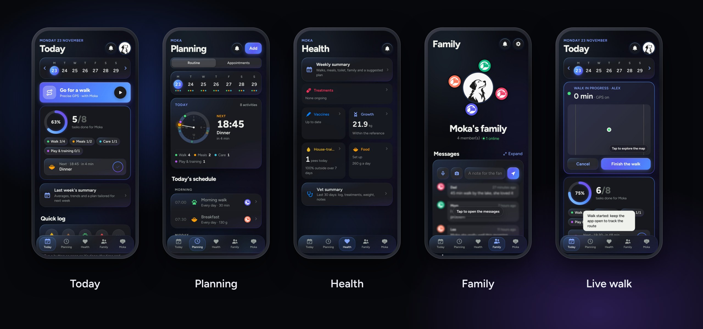

  

  <a href="https://wikzouustudio.com"><b>Open Dogs Life</b></a>
  &nbsp;·&nbsp; <a href="SECURITY.md">Security</a>

---

**Dogs Life** is a shared logbook for a family's dog. Everyone ticks off what they did, everyone sees it live, and nobody forgets the walk, the meal or the vaccine.

  

## Features

| | |
|---|---|
| **Today** | The dog's day at a glance: tasks to tick, what's next, one-tap quick log. |
| **Planning** | The weekly routine, appointments and the whole week in one view. |
| **Health** | Vaccines and recurring care, treatments, growth against the breed curve, house-training, food stock, vet summary. |
| **Walks** | Precise GPS tracking, live route shared with the family, map of every walk, suggested walks with the weather. |
| **Family** | Family and sitter roles, invite codes, messages with reactions, replies and voice notes, notification centre. |
| **Notifications** | Reminders before each task, follow-ups when something is missed, family activity, even with the app closed. |
| **Reports** | Daily and weekly summaries built only from what the family recorded. |
| **And more** | Multiple dogs, training, lost-dog poster, iPhone widget, 3D companion, 13 languages, themes, dark mode, works offline. |

## Install

1. Open **[wikzouustudio.com](https://wikzouustudio.com)** on your phone: Safari on iPhone, Chrome on Android.
2. Follow the 30-second tutorial on screen.
3. Open Dogs Life from its icon on your home screen.

## About this repository

This repository hosts the production build of the website. It is generated automatically and is not meant to be edited by hand.

---

© 2026 WIKZOUU STUDIO. All rights reserved.

